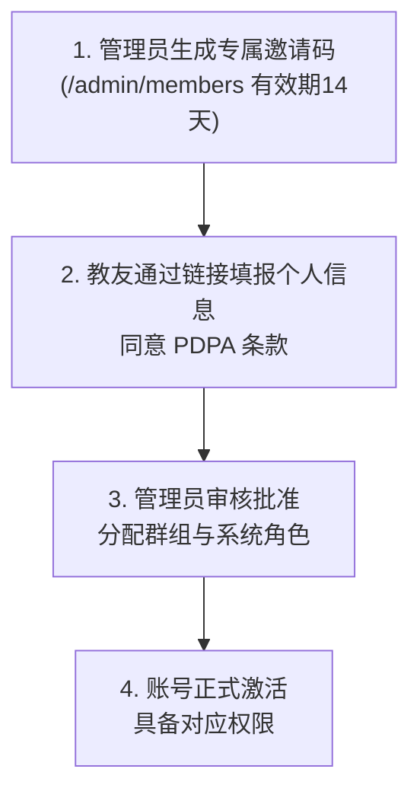
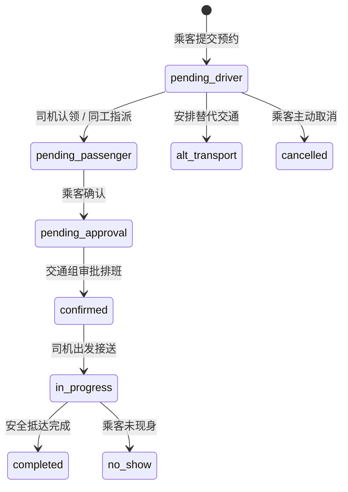

# 恩典同行 · Grace Ride 管理员与交通调度同工操作手册与注意事项

> **文件版本**：v1.0 (生产与内测管理规范)  
> **适用角色**：核心管理同工 (Superadmin / Admin)、交通部与调度员 (Transport / Traffic Head)、团契组长 (Cell Leader)、财务部同工 (Finance / Auditor)  
> **安全等级**：教会内部受限文档 (Internal Restricted)

---

## 第一部分：管理人员守则与核心安全法则 (Admin Invariants)

作为拥有管理与调度权限的同工，您所接触的数据涉及教友真实姓名、门牌地址、健康状况及财务往来。在操作后台时，必须严格恪守以下核心安全法则：

### 1. 权限最小化与双重验证 (2FA / Passkey) 强制
- **特权后台准入**：凡是访问【交通管理】（Transport）、【财务核算】（Finance）以及【系统管理】（Admin）区域的账号，**必须具备通行密钥（Passkey）或 TOTP 双重验证（2FA）**。任何仅使用弱密码且未经验证的会话将被服务器底层直接拦截。
- **专人专号，禁止借用**：严禁共用管理账号或借出登录状态，操作日志会自动记录操作者的 IP、时间与具体变更字段。

### 2. 双人制衡与特权约束 (Dual-Admin & Maker-Checker)
- **特权账号恢复双人机制 (Dual-Admin Recovery)**：
  若具有管理权限的同工丢失了手机或通行密钥，其账号恢复**必须由两位不同的管理员**在系统中发起并确认（发起人与确认人不可为同一人）。确认后，系统将自动撤销该账号此前所有的有效 Token、会话和密钥。
- **财务制单与打款分离 (Maker-Checker Separation)**：
  在审批志工车贴报销与生成月度打款批次（Payout Batches）时，**制单人与付款确认人必须分离**（系统代码级强制校验 `created_by != paid_by`），严防单人舞弊。

### 3. 数据合规与法定保留期 (Malaysian PDPA & Retention)
依据马来西亚《个人资料保护法》（PDPA 2010），本系统执行严格的数据自动清理周期，管理员切勿擅自私下导出或留存全教会教友隐私：
- **实时 GPS 位置**：仅在行程处于“进行中”时暂存内存与缓存，**行程一旦结束立即物理清除**；
- **行程临时聊天**：留存 180 天后自动物理归档；
- **通知消息**：已读通知保留 90 天，未读通知保留 1 年；
- **安全审计日志 (Audit Log)**：完整留存 2 年，不可被任何角色篡改或删除。

---

## 第二部分：账号、群组与权限管理 (`/admin/members`, `/admin/roles`)



### 1. 邀请与新会员审批
1. **生成单次邀请链接**：
   - 进入【管理后台】$\rightarrow$【会员与邀请】$\rightarrow$ 点击【生成邀请】；
   - 系统生成一条包含加密 Token 的独立 URL（有效期 14 天）；
   - 通过教会官方 WhatsApp 或电邮安全分发给目标教友。
2. **审核新会员入驻**：
   - 教友填写信息并同意条款后，账号处于“待审核”（Pending）状态，此时该账号无法访问任何业务数据；
   - 管理员核实该教友为本堂会友后，点击【批准入驻】，并为其指定所属团契群组与基础角色（通常默认为普通会员 `member` 或司机 `driver`）。

### 2. 树状群组管理 (Groups & Sub-groups)
系统支持最多 3 层的层级组织架构（防死循环树状校验）：
- **根群组示例**：成年部、乐龄部、青年部、儿童部、访客组 (`Visitor`)；
- **子群组示例**：成年部 $\rightarrow$ 仁爱小组、喜乐小组；乐龄部 $\rightarrow$ 松柏团契；
- **作用**：活动发布与约车匹配均严格按照群组及其子群组自动继承，实现活动权限与乘车隐私的严密隔离。

### 3. 5级职级链与权限角色体系
系统预置 13 种内置角色及 67 项原子权限，受到严格的五级职级链约束：
$$\text{Superadmin} > \text{President (主席)} > \text{Vice President (副主席)} > \text{Finance (财务)} > \text{Auditor (审计)}$$
- **下级无权修改上级**：例如普通 Admin 无法调整 Superadmin 的角色，副主席无权停用主席账号；
- **紧急账号停用机制**：若某志工司机因个人原因需临时停用，管理员在 `/admin/members` 将其状态调整为“已停用”：
  - 系统将**自动将其未开始的接送申请释放回公共等待池**；
  - 自动向受影响的乘客推送改派通知；
  - 交通看板上相关订单将被标注为需关注高亮（`needs_attention = 1`）。

---

## 第三部分：交通调度与排班看板实操 (`/admin/rides`, `/admin/events/:id/plan`)

交通调度是「恩典同行」的核心枢纽，本系统提供强大的桌面/移动端交互排班看板及智能辅助算法。



### 1. 约车生命周期流转规范
- **待司机认领 (`pending_driver`)**：教友提交约车，司机与调度员均可见模糊区域；
- **待乘客确认 (`pending_passenger`)**：司机接单或同工改派后，需乘客确认时间是否适宜；
- **待交通组审批 (`pending_approval`)**：交通调度员审核容量、路线及无障碍匹配情况；
- **已排定确认 (`confirmed`)**：**此时系统才对派定司机解密乘客具体门牌号**，并重置 1 小时就绪提醒机制；
- **行程进行中 (`in_progress`)**：司机在接驾路上，系统启用实时位置同步与行程聊天；
- **已完成 (`completed`)**：乘客安全抵达，位置共享终止，自动生成司机的里程津贴报销底表。

### 2. 交互式排班看板使用指南 (`/admin/events/:id/plan`)
每周主日崇拜前 2–3 天，交通组通过排班看板集中安排车位：

```
+--------------------------------------------------------------------------+
| 交通排班看板 · 主日早堂崇拜 (2026-11-29 08:30)                           |
+--------------------------------------------------------------------------+
| [智能辅助排班]  [匹配返程司机]  [撤销 Ctrl+Z]  [重做]      [保存排班(行锁)]|
+------------------------------------+-------------------------------------+
| 待安排乘客池 (Unassigned Riders)   | 志工车队 (Volunteer Drivers)        |
|                                    |                                     |
| [陈妈妈 · 轮椅需协助 · SS2]        | [车手A: 李弟兄 (Myvi · 剩余2座)]    |
| [蔡长辈 · 助行器 · Sec 14]         |  - 张弟兄 (SS2)                     |
| [黄弟兄 · 2位 · Sec 17]           |                                     |
|                                    | [车手B: 王弟兄 (Innova大车·剩余4座)]|
|                                    |  (支持轮椅搭载)                     |
+------------------------------------+-------------------------------------+
```

1. **拖拽与轻触指派**：
   - **电脑端**：直接将左侧待安排乘客拖拽至右侧符合条件的志工车辆卡片中；
   - **移动端 (手机/平板)**：轻触乘客卡片，弹出分配模态框，选择目标司机即可。
2. **多步撤销与重做**：
   - 调度过程中如误操作，随时可使用键盘快捷键 `Ctrl+Z`（Mac 为 `Cmd+Z`）或点击屏幕上方【撤销】恢复，避免混乱。
3. **智能辅助自动排班 (In-Group Auto-Arrange)**：
   - 点击上方**【智能排班建议】**按钮；
   - 算法会优先根据**无障碍需求**（如轮椅自动分配至 SUV/MPV 等大后备箱车辆）、**所属团契群组**及**顺风地理就近原则**进行试算；
   - 试算结果会附带清晰的中文推荐解释，未妥善安置的特殊乘客会标红预警，**不会直接静默覆盖**；调度员确认无误后方可保存。
4. **返程司机一键对齐 (Match Return Drivers)**：
   - 点击【匹配返程司机】，系统会自动将早堂送达的乘客与同司机的返程行程配对，极大减轻二次排班负担。
5. **原子防冲突保存 (Atomic Row-Lock)**：
   - 点击【保存排班】时，后台对涉及的司机数据行施加瞬时并发锁，杜绝两名调度同工同时操作造成的“抢座位”冲突。

### 3. 突发情况应急处置
- **志工临时请假**：在看板中点击司机卡片右上角的【释放全部乘客】，受影响乘客自动回流至待安排池，优先重新指派。
- **安排替代交通 (Alt Transport)**：若极端暴雨或严重缺车，同工可将订单置为“替代交通”，并线下联络出租车协助长辈，事后凭收据进入交通报销。
- **乘客未现身 (No-Show)**：司机抵达上车点超过 10 分钟且无法联络时，可由司机或调度员标记“未现身”，系统自动结束行程并记录异常日志。

---

## 第四部分：团契活动发布与现场签到管理 (`/admin/events`)

### 1. 发布群组限定活动
1. 进入【活动管理】$\rightarrow$【发起活动】；
2. **受众群体指定**：选择活动开放的目标群体（如选择“成年部”，则其下辖的所有团契小组均可自动查看；非受众群体在首页看不到此活动，约车亦自动脱敏为“教会活动”）；
3. **设定人数上限与候补**：开启名额上限。当报名人数满额后，后续教友将自动进入先进先出（FIFO）候补队列，有空额时系统自动按顺序递补；
4. **绑定签到功能**：默认开启出席统计模块。

### 2. 现场出席签到管理
聚会当天，同工可在 `/events/:id/checkin` 页面开展签到管理：
- **大屏幕投屏模式**：将页面的活动签到专属二维码（`checkin_code`）投屏到教会投影仪或展示在易拉宝上，会友入场时使用手机直接扫码即可秒速完成自签；
- **现场扫码枪/同工手持模式**：同工使用手机摄像头开启【扫码模式】，扫描长者出示的个人专属通行码（`pass_code`），屏幕显示绿框即代表核销成功，支持现场即时补录未报名人员。

### 3. 活动后志工司机疏散与宵夜车贴快速录入 (Post-Event Dispersal & Supper Reimbursements)
聚会或团契活动结束后，常有志工司机载同工前往宵夜聚餐，亦有部分司机直接驾车返家。为减轻现场同工负担并保障志工关怀：
1. **免录乘客清单**：无需逐一录入车上每位乘客姓名，现场交通组长或活动主办同工仅需在活动页面点击【登记散会车贴】（或在排班看板进入）；
2. **勾选司机与去向**：列表中自动汇总该活动的所有出车司机。同工勾选出车司机并选择其去向（直接返家 或 宵夜预设区域）；
3. **区域费率表自动套算**：系统严格依据既定区域间费率表（`area_fares`）基于 `(活动区域 ↔ 目的区域)` 自动计算里程津贴金额；
4. **即时入库为已批准 (`approved`)**：现场同工确认提交后，系统原子加锁查重并直接生成已批准状态的报销记录，同时向司机推送通知；
5. **财务无缝打款发放**：财务同工在月度报销发放列表（`/admin/reimbursements`）中可直接将这些已批准车贴并入当月打款批次并标记为已支付（`paid`），免去司机事后繁琐申请；
6. **乘客手机端意向联动**：返程乘客可在手机约车卡片上自主声明意向（“直接回家”或“参加宵夜”），便于排班名录上直接呈现提示徽章，辅助同工现场统筹。

---

## 第五部分：活动财务分摊与报销审批 (`/admin/reimbursements`, `/settlements`)

### 1. 活动费用分摊审核与对账
1. **费用账单发布审核**：发起人上传总支出、教会津贴扣除数、应分摊人数，以及个人收款 DuitNow QR 码。
2. **收据核对与单号查重**：
   - 参与人上传转账截图后，系统会自动比对交易流水号（Reference ID）；
   - 若出现重复单号（防止一张转账单用于多人冒领），系统会发出标红预警；
   - 收款人或财务核验到账后，确认该笔账单“已结清”。
3. **账单修改对账保护机制 (Revision Reconciliation)**：
   - 若账单发布后产生退款或金额变动，系统会**严格保留已付款教友的历史记录**，将变动部分转入“需补充信息”（Needs Info）对账池，严禁直接抹除历史转账记录。

### 2. 志工车贴报销与月度批次发放
1. **行程完成后自动算费**：志工司机顺利完成接送后，系统根据预设的每公里标准自动生成“待报销记录”；
2. **交通部初审**：交通组同工在 `/admin/reimbursements` 检查行程有效性与里程合理性，点击【批准初审】；
3. **财务部月度批次打款 (Payout Batches)**：
   - 财务同工将当月已初审的报销合并生成打款批次，一键导出银行发薪格式的 CSV 报表；
   - 出纳线下通过银行完成批量转账；
   - **双人签名生效**：由另一位财务同工在系统上传银行转账回单并点击【确认付款完成】，批次关闭归档。

---

## 第六部分：系统维护、审计与应急安全响应

### 1. 审计日志监督 (`/admin/audit`)
- 系统所有重要操作（包括修改用户角色、改派车辆、查看敏感地址、密码重置、财务审批）均会被系统无缝记录入库；
- 审计同工应定期进入审计面板，按日期和操作类型抽查是否有越权或异常访问记录。

### 2. 数据库备份与演练规范
为防范服务器意外损坏，系统已配置全自动化加密备份脚本：
- **每日自动快照**：每天凌晨系统自动运行 `scripts/backup.sh`，对 PostgreSQL 数据库及用户上传的收据凭证目录进行非对称加密压缩存储；
- **定期恢复演练**：IT 委员会每季度运行一次 `scripts/restore_drill.sh`，在非破坏性隔离沙盒中验证备份归档包的完整性与可恢复性，确保教会核心数据高枕无忧。
