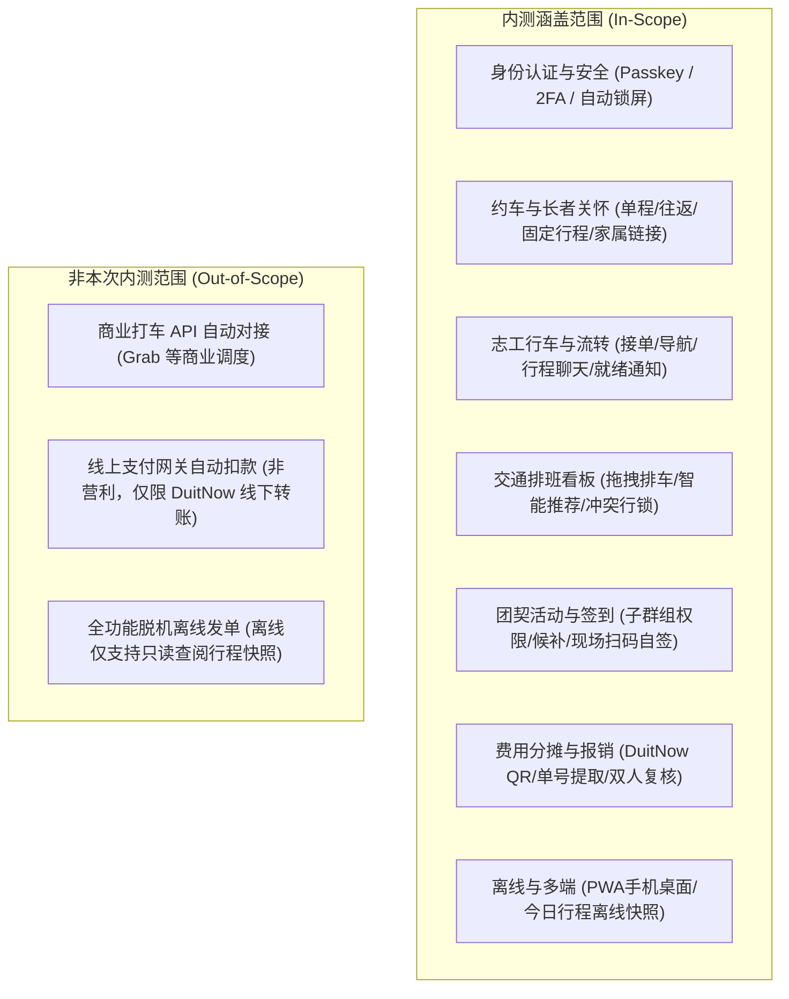
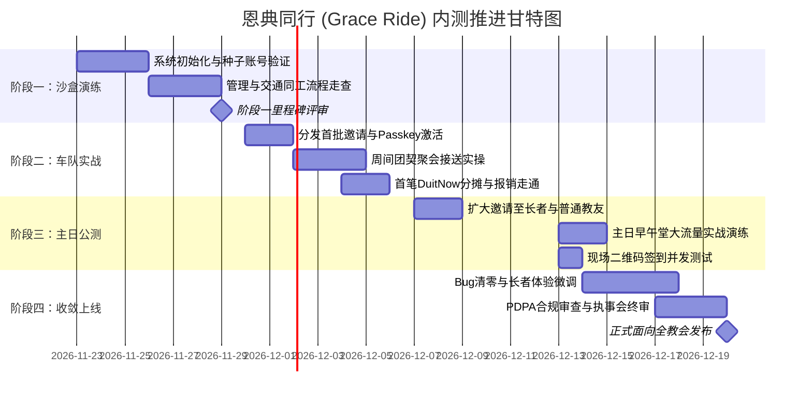

# 恩典同行 · Grace Ride 内测实施方案与时间表

> **文件版本**：v1.0 (内测正式版)  
> **适用机构**：八打灵神恩堂 (PJ State Chinese Methodist Church)  
> **保密级别**：教会内部测试专用 · 严禁外传  
> **生效日期**：2026 年 11 月

---

## 1. 内测背景与宗旨

「恩典同行 · Grace Ride」是专为八打灵神恩堂（PJ State CMC）定制的内部邀请制志工拼车、团契聚会与活动费用分摊系统。

本应用旨在解决主日崇拜与周间团契活动中长辈接送难、交通调度繁杂、活动分摊不清等实际痛点。为确保系统在正式向全教会推开时具备高度的安全性、稳定性和易用性，特制定本次封闭内测（Closed Beta）实施方案。

### 1.1 内测核心宗旨
1. **隐私安全先行 (Privacy-First)**：全面验证马来西亚《2010年个人资料保护法》（PDPA）合规落地，确保长辈与教友住址、行踪与健康辅助等敏感数据万无一失。
2. **长者体验友好 (Elder-Friendly)**：验证大字体界面、轮椅/助行器辅助需求匹配、家属代订与零登录“安全抵达”关怀链接的实际便利度。
3. **调度闭环高效 (Seamless Transport)**：检验交通部排班看板（拖拽排班、移动端适配、智能防冲突）在主日早午堂高并发场景下的吞吐与稳定性。
4. **财务透明清晰 (Ministry Finance)**：验证活动费用 AA 分摊精确到分（仙）、DuitNow QR 转账凭证识别以及志工车贴报销双人复核流程。

---

## 2. 内测范围界定 (Scope & Boundaries)

### 2.1 功能测试范围 (In-Scope)

| 业务模块 | 覆盖功能清单 | 验证重点 |
| :--- | :--- | :--- |
| **身份与权限** | 14天单次邀请链接、WebAuthn 通行密钥（指纹/人脸）、密码+TOTP双重验证、会话空闲自动锁屏、5级职级链与67项细粒度权限 | 免密码无缝登入率、公用设备防走漏保护、双人管理员账号恢复 |
| **接送预约** | 个人往返约车、为长辈/组员代订、每周固定行程（Recurring Rides）、模糊地址脱敏、无障碍辅助勾选（轮椅/助行器/上下车协助） | 派车前地址模糊保护、轮椅车型匹配度、长者常态免重复操作 |
| **安全关怀** | 零登录家属关怀“安全抵达”链接 (`/care/:token`)、乘客“已准备好”就绪提醒、行程实时位置与 ETA | 家属免登查看状态顺畅度、不泄露司机私人信息的安全边界 |
| **志工车队** | 志工车档维护（车型/座位/轮椅载力）、自由认领、行程流转（出发→到站→就绪→接到→送达）、加密行程聊天与表情 | 司机操作极简化、行车专注安全、点对点沟通无死角 |
| **交通统筹** | 交互式排班看板（桌面拖拽+手机卡片轻触）、组内智能自动排班算法、返程司机自动匹配、并发防抢单行锁 | 复杂主日排班效率、换车/改派通知机制、极端路线报警 |
| **活动与签到** | 团契层级受众隔离、名额超额 FIFO 自动候补、大屏活动签到二维码、教友专属通行码反向核销、ICS 日历导出 | 自驾与无车教友独立签到、现场并发扫码通行效率 |
| **财务分摊** | 整数“仙”（Cent）精确分摊、DuitNow QR 展示与一键复制金额、转账凭证/收据图片上传与单号自动提取、修订对账 | AA 制平账准确度、收据隐私遮挡合规、财务审批双人分离 |
| **离线与端能力** | PWA 手机主屏安装、Web Push 网页推送、断网“今日行程离线快照”（Offline Snapshot） | 弱网环境韧性、网络中断后关键司机联络信息可用性 |

### 2.2 明确排除范围 (Out-of-Scope)
1. **商业打车平台整合**：系统不嵌入 Grab 或出租车直接叫车 API；若遇无法匹配志工的极端情况，由交通部人工协调代用交通并线下报销。
2. **银行自动网银代扣**：为遵守马来西亚国家银行（BNM）金融监管，本系统定位为教会志工互助，不设线上充值钱包或代扣，统一采用教友主动 DuitNow 扫码转账并上传凭证。
3. **脱机全量离线写入**：应用离线模式严格受限于 `offlineSnapshot.ts`，仅提供当天已有行程的只读查阅，不支持断网发起新预约或变更排班。

---

## 3. 测试组织架构与角色矩阵

| 角色分组 | 代表群体 | 人数 | 主要职责与验证场景 |
| :--- | :--- | :--- | :--- |
| **系统管理员组** | 教会 IT 委员会、行政主任 | 3 人 | 系统参数配置、初始邀请下发、双人账号恢复演练、系统审计日志监督 |
| **交通调度组** | 交通部长、主日早午堂交通同工 | 5 人 | 排班看板深度实操、自动排班算法调优、突发改派与异常处理走查 |
| **志工司机车队** | 各牧区拥有车辆的志愿弟兄姐妹 | 12 人 | 接收预约提醒、查看路线导航联动（Waze/Google Maps）、行程状态变更 |
| **团契先锋组** | 乐龄团契、成青团契、青年团契组长 | 8 人 | 发起团契活动、为团契长辈代订接送、现场扫码签到、发起活动分摊 |
| **普通教友与长者**| 受邀普通会友、长者家庭 | 40 人 | 体验邀请激活、Passkey 登入、大字体使用、单次/固定约车、DuitNow 缴费 |
| **长者家属与访客**| 长辈子女（非本堂教友）、单次访客 | 10 人 | 测试免登录 `/care/:token` 关怀通知、单次访客乘车通行证 (`/visit/:token`) |
| **财务核销组** | 教会财务执事、会计同工 | 2 人 | 审核活动收款凭据、检验单号防重机制、执行月度志工车贴批次报销导出 |

---

## 4. 内测四阶段推进时间表 (Timeline)

整个内测周期拟定为 **4 周**（覆盖 4 个完整的周日崇拜与周间小组周期）：

### 详细阶段规划与交付物

#### 第一阶段：沙盒封闭演练 (Week 1)
- **重点工作**：
  1. 部署预发测试环境，建立教会服务区域（SS2、Damansara Utama、Section 14 等）；
  2. 录入系统基础角色（交通部、团契长、财务同工）；
  3. 交通同工集中培训，模拟 50 位虚拟乘客在 10 辆志工车间的排班调度，检验自动排班合理性；
  4. 验证 Web Push 推送与 WhatsApp 告警通道连通性。
- **阶段验收标准**：P0 级阻断性缺陷清零，交通组核心同工熟练掌握排班看板。

#### 第二阶段：志工车队与周间小组小范围实战 (Week 2)
- **重点工作**：
  1. 向 12 位志工司机及 2 个团契小组（约 30 位教友）定向下发专属邀请；
  2. 指导在手机上建立 Passkey 及安装至桌面（PWA）；
  3. 在真实的周三祷告会与周五团契聚会中实操：教友约车、司机接单接送、现场扫码签到；
  4. 聚会后由团契长发起一笔茶点费用分摊，教友通过 DuitNow 扫码付款并上传截图，财务复核。
- **阶段验收标准**：移动端流程流畅度达标，首批真实接送与分摊全部平账。

#### 第三阶段：主日崇拜全场景联合演练 (Week 3)
- **重点工作**：
  1. 测试人群扩大至 60–80 人，重点引入行动不便的长者及其子女；
  2. 实战演练主日早堂与午堂的集中接送，重点检验轮椅车型无障碍匹配；
  3. 检验长者子女接收 `/care/:token` 关怀链接的体验（是否准时收到抵达提醒）；
  4. 崇拜现场入口易拉宝与大屏幕展示活动签到二维码，开展百人级扫码签到抗压测试。
- **阶段验收标准**：主日接送匹配率达到 95% 以上，家属关怀链接正常推送，无现场拥堵或排班混乱。

#### 第四阶段：问题收敛与正式上线评估 (Week 4)
- **重点工作**：
  1. 集中修复各端反馈的排版错位、文字表述及交互不便之处；
  2. 针对长者反馈进一步优化字体缩放与高对比度显示；
  3. 财务组汇总内测期间志工司机的油费与过路费津贴报销，完成月度批次导出与打款归档；
  4. 组织执事会与牧者团队进行《内测验收总结报告》签署，通过正式上线决议。
- **阶段验收标准**：所有提交的缺陷均被解决或评估降级，形成标准化用户服务流程。

---

## 5. 准入与准出标准 (Criteria)

### 5.1 准入标准 (Entry Criteria)
- [x] 后台所有 27 个功能页面及 67 项权限通过代码审计与自动化测试；
- [x] 马来西亚 OSRM 离线地图与路径规划服务平稳运行；
- [x] 种子管理账号通过安全加固，双重验证（2FA）与通行密钥正常工作；
- [x] 《普通用户手册》与《管理员操作手册》编撰就绪。

### 5.2 准出标准 (Exit Criteria)
- [ ] 内测期累计完成不少于 50 趟真实志工接送，无重大安全纠纷；
- [ ] 系统无严重缺陷（P0 / P1 为 0，P2 缺陷低于 3 项且有规避方案）；
- [ ] 长者或其家属对接送体验满意度高于 90%；
- [ ] 费用分摊与财务凭证核销账实相符，平账率 100%；
- [ ] 教会执事会与交通部正式签署上线批件。

---

## 6. 应急预案与安全响应机制

1. **志工司机突发缺席/车辆故障**：
   - 当值司机若在接送前 2 小时内突发异常，系统允许一键点击“紧急报告”。交通部监控大屏即刻亮起红灯警告，调度同工可在看板上直接一键“改派”给备班司机，系统同时向受影响乘客发送 WhatsApp/短信紧急通告。
2. **聚会现场无网络或信号瘫痪**：
   - 现场教友即使断网，仍可凭借 PWA 离线快照（`offlineSnapshot.ts`）查看当天的接送安排与司机电话；
   - 签到同工可启动离线签到表模式，待恢复网络后一键同步。
3. **数据安全与隐私防泄**：
   - 如发生疑似凭证泄露或设备遗失，管理员可在 `/admin/members` 页面一键“强制撤销全部会话并锁定账号”，旧手机上的任何 Token 与通行凭据立即失效。
