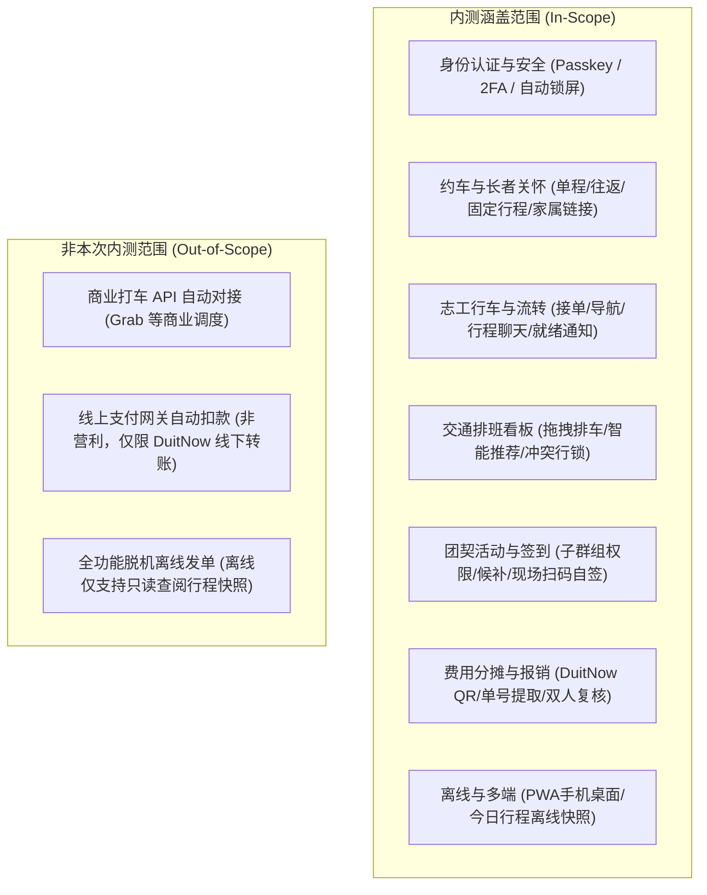
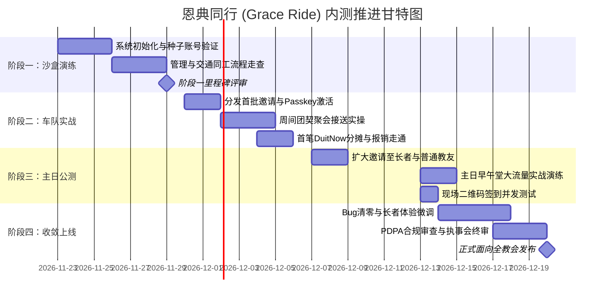
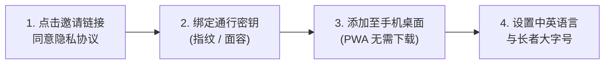
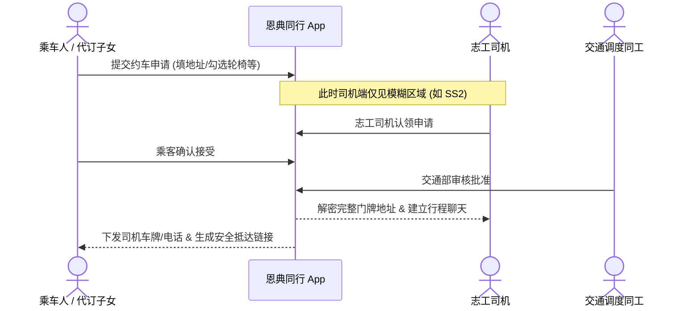
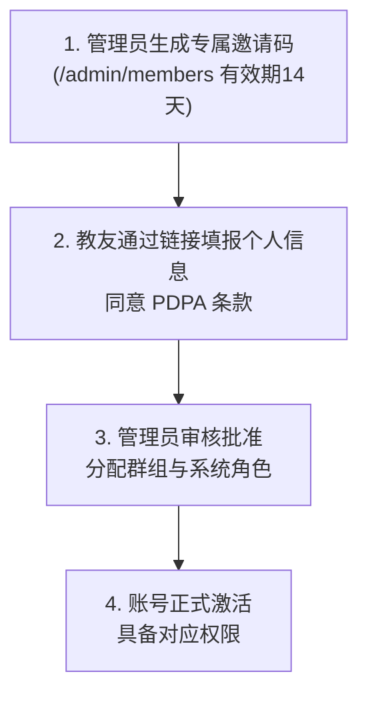
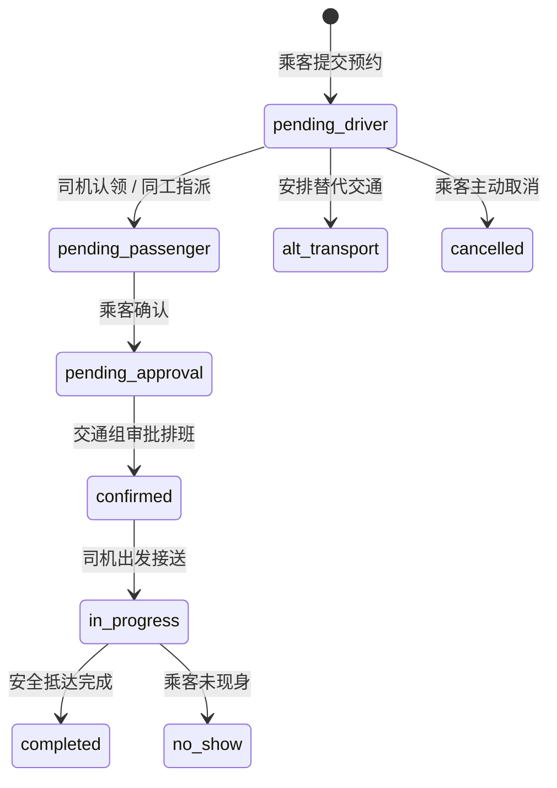

# 恩典同行 · Grace Ride 文档套件全集 (合订本)

> **适用机构**：八打灵神恩堂 (PJ State Chinese Methodist Church)  
> **系统定位**：内部邀请制志工拼车、团契聚会与活动费用分摊系统  
> **包含文档**：
> 1. 《恩典同行 · Grace Ride 内测实施方案与时间表》
> 2. 《恩典同行 · Grace Ride 普通用户注意事项与使用手册》
> 3. 《恩典同行 · Grace Ride 管理员与交通调度同工操作手册与注意事项》

---

# 第一部分：内测实施方案与时间表

> **文件版本**：v1.0 (内测正式版)  
> **适用机构**：八打灵神恩堂 (PJ State CMC)  
> **保密级别**：教会内部测试专用 · 严禁外传  

---

## 1. 内测背景与宗旨

「恩典同行 · Grace Ride」是专为八打灵神恩堂（PJ State CMC）定制的内部邀请制志工拼车、团契聚会与活动费用分摊系统。

本应用旨在解决主日崇拜与周间团契活动中长辈接送难、交通调度繁杂、活动分摊不清等实际痛点。为确保系统在正式向全教会推开时具备高度的安全性、稳定性和易用性，特制定本次封闭内测（Closed Beta）实施方案。

### 1.1 内测核心宗旨
1. **隐私安全先行 (Privacy-First)**：全面验证马来西亚《2010年个人资料保护法》（PDPA）合规落地，确保长辈与教友住址、行踪与健康辅助等敏感数据万无一失。
2. **长者体验友好 (Elder-Friendly)**：验证大字体界面、轮椅/助行器辅助需求匹配、家属代订与零登录“安全抵达”关怀链接的实际便利度。
3. **调度闭环高效 (Seamless Transport)**：检验交通部排班看板（拖拽排班、移动端适配、智能防冲突）在主日早午堂高并发场景下的吞吐与稳定性。
4. **财务透明清晰 (Ministry Finance)**：验证活动费用 AA 分摊精确到分（仙）、DuitNow QR 转账凭证识别以及志工车贴报销双人复核流程。

---

## 2. 内测范围界定 (Scope & Boundaries)

### 2.1 功能测试范围 (In-Scope)

| 业务模块 | 覆盖功能清单 | 验证重点 |
| :--- | :--- | :--- |
| **身份与权限** | 14天单次邀请链接、WebAuthn 通行密钥（指纹/人脸）、密码+TOTP双重验证、会话空闲自动锁屏、5级职级链与67项细粒度权限 | 免密码无缝登入率、公用设备防走漏保护、双人管理员账号恢复 |
| **接送预约** | 个人往返约车、为长辈/组员代订、每周固定行程（Recurring Rides）、模糊地址脱敏、无障碍辅助勾选（轮椅/助行器/上下车协助） | 派车前地址模糊保护、轮椅车型匹配度、长者常态免重复操作 |
| **安全关怀** | 零登录家属关怀“安全抵达”链接 (`/care/:token`)、乘客“已准备好”就绪提醒、行程实时位置与 ETA | 家属免登查看状态顺畅度、不泄露司机私人信息的安全边界 |
| **志工车队** | 志工车档维护（车型/座位/轮椅载力）、自由认领、行程流转（出发→到站→就绪→接到→送达）、加密行程聊天与表情 | 司机操作极简化、行车专注安全、点对点沟通无死角 |
| **交通统筹** | 交互式排班看板（桌面拖拽+手机卡片轻触）、组内智能自动排班算法、返程司机自动匹配、并发防抢单行锁 | 复杂主日排班效率、换车/改派通知机制、极端路线报警 |
| **活动与签到** | 团契层级受众隔离、名额超额 FIFO 自动候补、大屏活动签到二维码、教友专属通行码反向核销、ICS 日历导出 | 自驾与无车教友独立签到、现场并发扫码通行效率 |
| **财务分摊** | 整数“仙”（Cent）精确分摊、DuitNow QR 展示与一键复制金额、转账凭证/收据图片上传与单号自动提取、修订对账 | AA 制平账准确度、收据隐私遮挡合规、财务审批双人分离 |
| **离线与端能力** | PWA 手机主屏安装、Web Push 网页推送、断网“今日行程离线快照”（Offline Snapshot） | 弱网环境韧性、网络中断后关键司机联络信息可用性 |

### 2.2 明确排除范围 (Out-of-Scope)
1. **商业打车平台整合**：系统不嵌入 Grab 或出租车直接叫车 API；若遇无法匹配志工的极端情况，由交通部人工协调代用交通并线下报销。
2. **银行自动网银代扣**：为遵守马来西亚国家银行（BNM）金融监管，本系统定位为教会志工互助，不设线上充值钱包或代扣，统一采用教友主动 DuitNow 扫码转账并上传凭证。
3. **脱机全量离线写入**：应用离线模式严格受限于 `offlineSnapshot.ts`，仅提供当天已有行程的只读查阅，不支持断网发起新预约或变更排班。

---

## 3. 测试组织架构与角色矩阵

| 角色分组 | 代表群体 | 人数 | 主要职责与验证场景 |
| :--- | :--- | :--- | :--- |
| **系统管理员组** | 教会 IT 委员会、行政主任 | 3 人 | 系统参数配置、初始邀请下发、双人账号恢复演练、系统审计日志监督 |
| **交通调度组** | 交通部长、主日早午堂交通同工 | 5 人 | 排班看板深度实操、自动排班算法调优、突发改派与异常处理走查 |
| **志工司机车队** | 各牧区拥有车辆的志愿弟兄姐妹 | 12 人 | 接收预约提醒、查看路线导航联动（Waze/Google Maps）、行程状态变更 |
| **团契先锋组** | 乐龄团契、成青团契、青年团契组长 | 8 人 | 发起团契活动、为团契长辈代订接送、现场扫码签到、发起活动分摊 |
| **普通教友与长者**| 受邀普通会友、长者家庭 | 40 人 | 体验邀请激活、Passkey 登入、大字体使用、单次/固定约车、DuitNow 缴费 |
| **长者家属与访客**| 长辈子女（非本堂教友）、单次访客 | 10 人 | 测试免登录 `/care/:token` 关怀通知、单次访客乘车通行证 (`/visit/:token`) |
| **财务核销组** | 教会财务执事、会计同工 | 2 人 | 审核活动收款凭据、检验单号防重机制、执行月度志工车贴批次报销导出 |

---

## 4. 内测四阶段推进时间表 (Timeline)

整个内测周期拟定为 **4 周**（覆盖 4 个完整的周日崇拜与周间小组周期）：

### 阶段规划要点
1. **第一阶段：沙盒封闭演练 (Week 1)**：配置测试环境、初始化种子数据、走通端到端排班与告警通道。
2. **第二阶段：车队与小组实战 (Week 2)**：定向邀请12位志工司机与2个团契小组，在周间团契聚会中实战预约、接单、扫码签到与 DuitNow AA 分摊。
3. **第三阶段：主日崇拜联合演练 (Week 3)**：扩大至 60–80 人，检验早午堂高峰、轮椅车位匹配、家属安全抵达关怀链接及大屏幕二维码并发签到。
4. **第四阶段：问题收敛与上线评估 (Week 4)**：缺陷清单清零、长者字体微调、月度车贴报销归档、执事会签署正式全教会发布批件。

---

# 第二部分：普通用户注意事项与使用手册

> **让关爱一路相伴 · Care that walks with you**  
> 专为八打灵神恩堂（PJ State CMC）教友打造的邀请制志工拼车、团契聚会与活动费用分摊应用。

---

## 1. 用户守则与重要注意事项

### 1.1 账号与隐私安全须知 (PDPA 合规)
- **专属邀请，一人一号**：您的注册邀请链接是单次有效的，时效为 14 天。请勿将邀请链接转发给其他非本堂教友。
- **免记密码，指纹通行**：强烈建议按照提示绑定手机的**通行密钥（Passkey 指纹/人脸识别）**。这不仅能让您秒速登录，更能杜绝密码被盗的风险。
- **上车住址隐私保护**：为了保护教友的居家安全，您的具体住址门牌号在交通组正式批准派车前是严格保密的，待接单司机仅能看到粗略区域（如 SS2、Section 14）；只有获派负责接送您的志工司机才能在出发前看到准确门牌。
- **账单与收据脱敏**：在参与活动 AA 分摊上传银行或 Touch 'n Go 转账截图时，请自行注意遮盖银行账户结余等高度私人敏感数字。
- **公共设备及时锁屏**：如果您在教会公用电脑上登录，使用完毕请点击右上角【锁定】或【登出】。系统亦会在长时间闲置后自动锁定屏幕保护您的隐私。

### 1.2 志工接送与行车安全须知
- **爱心互助，非商业营运**：
  「恩典同行」纯属教会弟兄姐妹之间的志愿爱心拼车，**不收取任何商业车资、中介费或利润**。志工司机无偿奉献时间与车辆，请怀着感恩的心彼此配搭。
- **司机规范**：
  所有志工司机均持有合法有效驾照、车辆路税（Road Tax）及有效车险。行车期间，司机必须遵守道路交规，**严禁在行车移动过程中操作手机**（所有状态更新应在出发前或安全停稳后进行）。
- **乘客礼仪与守时**：
  请于约定的接送时间**提前 5–10 分钟**在约定地点准备好。当司机即将到达时，请在手机上轻触**【我已准备好】**，让司机安心。若临时因身体不适或紧急事务无法乘车，请尽早告知。

### 1.3 活动费用分摊规范
- 活动 AA 制费用严格按照发起人核算的实际支出，精准到“仙”（Cent）；
- 请务必使用 **DuitNow QR / TNG eWallet / 手机银行** 转账至指定发起人，并在转账备注填入系统参考号，转账后截屏上传作为对账凭证。

---

## 2. 新手极速上手 (3分钟完成)

### 步骤 1：激活账号与绑定通行密钥 (Passkey)
1. 在手机上打开教会同工发给您的 WhatsApp / 短信专属邀请链接；
2. 浏览《使用条款与隐私声明》，勾选底部的**“我已阅读并选择加入”**；
3. 点击【创建通行密钥】按钮（iPhone 调起 FaceID/TouchID，Android 调起指纹即可秒速绑定）。

### 步骤 2：添加应用到手机主屏幕 (无需去应用商店)
为了像普通手机 App 一样方便，请将网页添加至主屏幕（您也可以随时进入底部导航的**【个人资料】(Profile)** 页面点击**【添加应用到手机桌面】**进行操作）：
- **安卓手机 Android (Chrome 浏览器)**：
  - **最快方式**：进入【个人资料】Tab，直接点击顶部的**【一键添加到桌面】**按钮，在弹出的系统对话框中确认即可！
  - **手动方式**：点击屏幕右上角的菜单（三个竖点 ⋮），点击**【安装应用】(Install App)** 或 **【添加到主屏幕】**确认即可。
- **苹果手机 iPhone (Safari 浏览器)**：
  点击底部的【分享】按钮（带有向上箭头的正方形小图标 ↑），找到并点击**【添加到主屏幕】(Add to Home Screen)**，点击右上角【添加】即可（在【个人资料】中点击亦可查看直观图文步骤指引）。

### 步骤 3：调整显示语言与长者大字体
- 点击应用右上角您的【个人头像】→【个人资料】；
- 可自由切换【简体中文 / 繁體中文 / English】；开启**【大字体关怀模式】**方便长辈阅读。

---

## 3. 主日崇拜与团契约车指南

1. **申请单次接送**：进入【接送】→【报名接送】。
   - 可选【为自己预约】或【为长辈/组员代订】；
   - 填写上车地点及门牌号；
   - **特殊行动辅助勾选**：若需轮椅、助行器、上下车搀扶或视力协助，请务必勾选对应选项；
   - 勾选“同时预约返程”即可一键锁定往返。
2. **设置“每周固定行程”（长者常态化接送推荐）**：
   - 进入【接送】→【固定行程】；
   - 设定每周日固定崇拜接送时间与地点，保存后每周自动生成预约，长辈省心无忧。

---

## 4. 行程当天乘车与家人关怀

1. **查看司机信息**：审批后在【我的接送】可查看司机姓名、照片、汽车型号与车牌号码。
2. **提前告知就绪**：出门前轻触**【我已准备好】（Ready）**，司机端地图亮起绿色就绪标志。
3. **实时位置查看**：司机出发后，地图展示实时路线与到达倒计时（ETA）。
4. **分享“安全抵达链接”给家人**：
   - 点击**【分享安全链接】**通过 WhatsApp 发送给子女；
   - **家人无需注册、无需下载任何 App**，点开链接即可实时看到长辈是否已平安抵达教会，全程放心。

---

## 5. 团契活动报名与现场扫码签到

1. **活动报名与自动候补**：进入【活动】浏览所属团契聚会，一键报名。名额超额自动进入先进先出（FIFO）候补。
2. **现场扫码签到**：
   - **方式一（主动扫码）**：现场打开活动页面，点击【扫码签到】，扫描现场大屏幕或易拉宝二维码秒速签到；
   - **方式二（通行证核销）**：出示个人专属通行码由现场同工扫码核销。

---

## 6. 活动费用 AA 分摊与转账

1. **查看分摊账单**：进入【我的费用】，查看账单明细与精准到仙的个人应付金额（如 RM 18.50）。
2. **转账支付**：点击【收款码】获取 DuitNow QR 码，使用银行 App 或 TNG 电子钱包扫码转账。
3. **上传转账凭证**：截屏电子收据后上传，系统自动提取交易参考单号（Reference ID），提交后等待发起人核对结清。

---

# 第三部分：管理员与交通调度同工操作手册与注意事项

> **文件版本**：v1.0 (生产与内测管理规范)  
> **适用角色**：核心管理同工 (Superadmin / Admin)、交通部与调度员 (Transport / Traffic Head)、团契组长 (Cell Leader)、财务部同工 (Finance / Auditor)  

---

## 1. 管理人员守则与核心安全法则 (Admin Invariants)

### 1.1 权限最小化与双重验证 (2FA / Passkey) 强制
- 凡访问【交通管理】、【财务核算】及【系统管理】区域的账号，**必须具备通行密钥（Passkey）或 TOTP 双重验证（2FA）**。
- 严禁共用账号，系统审计日志自动记录每一次操作的 IP 与时间。

### 1.2 双人制衡与特权约束 (Dual-Admin & Maker-Checker)
- **特权账号恢复双人机制**：管理员账号遗失密钥，**必须由两位不同的管理员**在系统中发起并确认方可生成恢复链接。
- **财务制单与打款分离**：报销制单人与付款确认人必须分离（系统代码级校验 `created_by != paid_by`）。

### 1.3 数据合规与法定保留期 (Malaysian PDPA & Retention)
- **实时 GPS 位置**：行程结束即刻物理清除；
- **行程聊天**：留存 180 天后自动物理归档；
- **通知消息**：已读保留 90 天，未读保留 1 年；
- **安全审计日志**：完整留存 2 年，不可被任何角色篡改或删除。

---

## 2. 账号、群组与权限管理 (`/admin/members`, `/admin/roles`)

1. **生成单次邀请链接**：在【会员与邀请】中生成 14 天有效独立邀请 URL，通过官方渠道下发。
2. **新会员入驻审批**：核实教友身份后点击批准，并分配所属团契群组与基础权限角色。
3. **树状群组管理**：支持最多 3 层群组层级结构（成年部、乐龄部、青年部等），活动与约车受众严格隔离并向下自动继承。
4. **5 级职级链与紧急停用**：
   - 职级链：$\text{Superadmin} > \text{President} > \text{Vice President} > \text{Finance} > \text{Auditor}$；
   - 停用志工司机时，系统自动释放其未开始接送回等待池，并标红提醒交通组重新改派。

---

## 3. 交通调度与排班看板实操 (`/admin/rides`, `/admin/events/:id/plan`)

### 排班看板关键操作
1. **拖拽与卡片轻触指派**：电脑端支持将待分配乘客直接拖入目标车辆；手机端轻触卡片选择司机。
2. **多步撤销与重做**：支持 `Ctrl+Z` / `Cmd+Z` 随时回滚排班失误。
3. **智能辅助自动排班 (In-Group Auto-Arrange)**：一键试算兼顾轮椅无障碍、同团契归属与顺风路线的最佳排班组合，附带中文解释，调度员确认后方可保存。
4. **返程司机一键配对 (Match Return Drivers)**：一键将去程与返程绑定同一司机。
5. **并发防冲突行锁 (Atomic Row-Lock)**：保存时施加瞬时并发锁，杜绝抢座位冲突。

---

## 4. 团契活动发布与现场签到管理 (`/admin/events`)

1. **限定群组活动发布**：指定开放群组，子群组自动继承，非受众群体无法查看。
2. **人数上限与 FIFO 候补**：名额满员后自动开启排队队列。
3. **现场签到组织**：
   - 将活动二维码投屏至投影仪，教友手机直接扫码签到；
   - 同工手持手机扫描教友个人通行码快速完成出席登记。

---

## 5. 活动财务分摊与报销审批 (`/admin/reimbursements`, `/settlements`)

1. **分摊审核与单号查重**：核验账单总额与 DuitNow QR，系统智能防范一张转账单用于多人冒领。
2. **账单修改对账保护**：修改金额时完整保留已付款教友的历史记录，将变动差额转入对账池。
3. **志工车贴批次核销**：
   - 接送完成后系统根据里程自动生成待报销单；
   - 交通部初审里程合理性；
   - 财务部合并生成打款批次，导出银行报表批量转账，双人签名确认归档。

---

## 6. 系统维护、审计与应急安全响应

1. **审计日志监视 (`/admin/audit`)**：定期复核特权变更、改派记录与敏感信息访问日志。
2. **每日加密备份与演练**：系统每夜自动运行 `scripts/backup.sh` 进行非对称加密快照；每季度运行 `scripts/restore_drill.sh` 进行沙盒容灾演练，确保教会数据万无一失。
