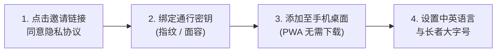
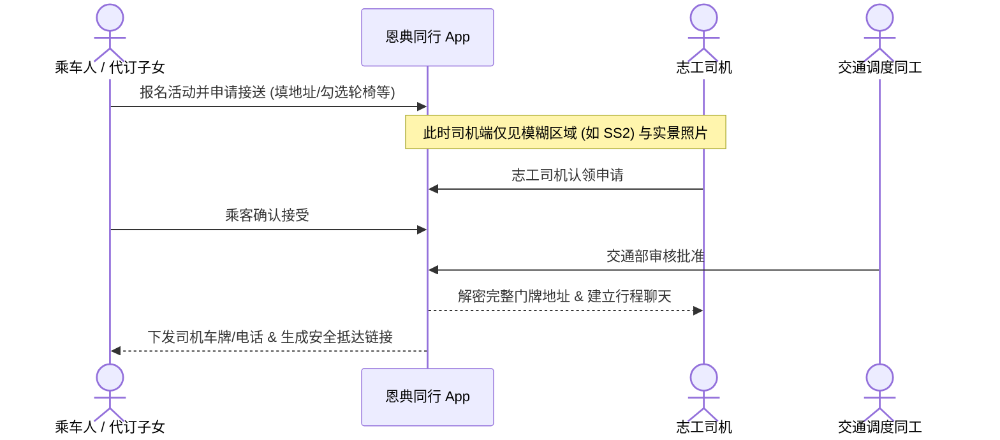

# 恩典同行 · Grace Ride 普通用户注意事项与使用手册

> **让关爱一路相伴 · Care that walks with you**  
> 专为八打灵神恩堂（PJ State CMC）教友打造的邀请制志工拼车、团契聚会与活动费用分摊应用。

---

## 第一部分：用户守则与重要注意事项

为了保障您与长辈的安全，维护教会弟兄姐妹之间的爱心信任，并遵守马来西亚个人资料保护法律，请在开始使用前仔细阅读以下守则：

### 1. 账号与隐私安全须知 (PDPA 合规)
- **专属邀请，一人一号**：您的注册邀请链接是单次有效的，时效为 14 天。请勿将邀请链接转发给其他非本堂教友。
- **免记密码，指纹通行**：强烈建议按照提示绑定手机的**通行密钥（Passkey 指纹/人脸识别）**。这不仅能让您秒速登录，更能杜绝密码被盗的风险。
- **上车住址隐私保护**：为了保护教友的居家安全，您的具体住址门牌号在交通组正式批准派车前是严格保密的，待接单司机仅能看到粗略区域（如 SS2、Section 14）；只有获派负责接送您的志工司机才能在出发前看到准确门牌。
- **账单与收据脱敏**：在参与活动 AA 分摊上传银行或 Touch 'n Go 转账截图时，请自行注意遮盖银行账户结余等高度私人敏感数字。
- **公共设备及时锁屏**：如果您在教会公用电脑上登录，使用完毕请点击右上角【锁定】或【登出】。系统亦会在长时间闲置后自动锁定屏幕保护您的隐私。

### 2. 志工接送与行车安全须知
- **爱心互助，非商业营运**：
  「恩典同行」纯属教会弟兄姐妹之间的志愿爱心拼车，**不收取任何商业车资、中介费或利润**。志工司机无偿奉献时间与车辆，请怀着感恩的心彼此配搭。
- **司机规范**：
  所有志工司机均持有合法有效驾照、车辆路税（Road Tax）及有效车险。行车期间，司机必须遵守道路交规，**严禁在行车移动过程中操作手机**（所有状态更新应在出发前或安全停稳后进行）。
- **乘客礼仪与守时**：
  请于约定的接送时间**提前 5–10 分钟**在约定地点准备好。当司机即将到达时，请在手机上轻触**【我已准备好】**，让司机安心。若临时因身体不适或紧急事务无法乘车，请尽早告知。

### 3. 活动费用分摊规范
- 活动 AA 制费用严格按照发起人核算的实际支出，精准到“仙”（Cent）；
- 请务必使用 **DuitNow QR / TNG eWallet / 手机银行** 转账至指定发起人，并在转账备注填入系统参考号，转账后截屏上传作为对账凭证。

---

## 第二部分：新手极速上手 (3分钟完成)

### 步骤 1：激活账号与绑定通行密钥 (Passkey)
1. 在手机上打开教会同工发给您的 WhatsApp / 短信专属邀请链接；
2. > **提示**：若在微信或 WhatsApp 内置浏览器中打开登录页，页面顶部会弹出提醒，请先点击右上角选择**【在 Safari / 系统浏览器中打开】**，以免内置浏览器无法正常调用通行密钥（Passkey）。
3. 浏览《使用条款与隐私声明》（支持中、英及马来文切换对照），勾选底部的**“我已阅读并选择加入”**；
4. 点击【创建通行密钥】按钮：
   - **苹果手机 (iPhone)**：屏幕弹出 FaceID（刷脸）或 TouchID（指纹），确认即可；
   - **安卓手机 (Android)**：屏幕弹出指纹感应或锁屏密码，确认即可；
   > **提示**：绑定后，以后每次进入应用只需按一下指纹即可登入，再也不用担心忘记密码！

### 步骤 2：添加应用到手机主屏幕 (无需去应用商店)
为了像普通手机 App 一样方便，请将网页添加至主屏幕（您也可以随时进入底部导航的**【个人资料】(Profile)** 页面点击**【添加应用到手机桌面】**进行操作；安卓用户亦可安装原生 Android 客户端）：

- **安卓手机 Android (使用 Chrome 浏览器打开)**：
  - **最快方式**：进入【个人资料】Tab，直接点击顶部的**【一键添加到桌面】**按钮，在弹出的系统对话框中确认即可！
  - **手动方式**：点击 Chrome 屏幕右上角的菜单（三个竖点 $\vdots$）$\rightarrow$ 点击**【安装应用】(Install App)** 或 **【添加到主屏幕】** $\rightarrow$ 确认添加。
- **苹果手机 iPhone (使用 Safari 浏览器打开)**：
  1. 点击 Safari 底部的【分享】按钮（带有向上箭头的正方形小图标 $\uparrow$）；
  2. 向上滑动选项列表，找到并点击**【添加到主屏幕】(Add to Home Screen)**；
  3. 点击右上角的【添加】。手机桌面上就会出现“恩典同行”金色图标。
  > **提示**：若在【个人资料】Tab 中点击该项，亦会弹出详细的图文步骤引导指引。若在微信/WhatsApp 内置浏览器中打开，请先点击右上角选择【在 Safari 中打开】。

#### 添加到主屏幕后：开启手机推送、通知偏好与 Telegram 绑定 (Allow Notifications)
1. 从手机桌面点击“恩典同行”图标打开已安装的应用（PWA），或打开原生 **Android 客户端**；
2. 进入顶部铃铛图标的**【通知】(Notifications)** 页面（或进入**【个人资料】→【偏好设置】/【安装指引】**），轻触**【开启通知】(Enable Notifications)** 按钮；
3. iOS 或 Android 系统将弹出权限确认框（例如：`"Grace Ride" Would Like to Send You Notifications` / 是否允许通知，选项为 **Don't Allow / 不允许** 与 **Allow / 允许**）；
4. 请务必点击**【允许】(Allow)**——由于手机系统安全限制，应用无法自动代您授予通知权限；
5. **个性化通知偏好**：在通知设置中，您可以按类别静音非紧急通知、设置**免打扰时段（Quiet Hours）**、开启**锁屏隐藏敏感详情**（防止他人偷窥行程详情），司机亦可自定义出发前提醒提前量（15–180 分钟）；
6. **Telegram 一键绑定**：如教会后台已配置 Telegram Bot，您可在【个人资料】中点击一键配对链接（`t.me/...`）绑定个人 Telegram 接收行程提醒；
7. **Android 客户端通知特性**：原生安卓端按“紧急接送 / 行程动态 / 行程群聊 / 教会公告”分为 4 个独立通知频道，支持在**通知栏直接快捷回复**行程聊天消息。
> **若此前误点了“不允许”**：
> - **iPhone / iPad**：前往手机【设置】→【通知】→ 找到并进入【恩典同行】(Grace Ride) → 打开【允许通知】；
> - **Android**：前往手机【设置】→【通知】（或点击 Chrome 地址栏左侧图标）→ 允许【恩典同行】发送通知。

### 步骤 3：调整显示语言、深色模式、长者大字体与头像工坊
- 点击应用右上角您的【个人头像】$\rightarrow$【个人资料】；
- **语言切换**：可选择**【简体中文】**或**【English】**（《使用条款与隐私声明》页面同时提供 **Bahasa Malaysia** 马来文版本切换）；
- **外观模式与大字体关怀模式**：网页端与原生 Android 端均支持在**跟随系统 / 浅色 / 深色**模式间切换；调节字体缩放或手机系统字体大小，界面文字即刻放大，方便长辈阅读；
- **头像个性化与机器人头像工坊 (Grok Bot Studio)**：
  - 轻触头像卡片，可拍照或上传照片/动图（支持静态图及 GIF/WebP，系统自动裁剪压缩至 512 像素以内并清除照片拍摄地点隐私）；
  - 亦可选择文字缩写、彩色图标、动态萌物造型（安卓端采用本地原生画布动画与高清晰 WebP 图标），或点击进入**【Grok Bot Studio 机器人头像工坊】**（网页路径 `/studio`，安卓端亦可原生开启）：自由搭配 **8 种黏土造型 × 16 种表情 × 12 种配色**，预览动作、点击“随机惊喜”，一键设为个人头像，或导出 PNG/SVG 图片与好友分享；
  - 设置的头像会同步显示在顶部导航、锁屏界面、接送卡片及成员列表中。
- **四级成就徽章与个人报告**：在个人报告页面（支持按**月度、季度、年度**查阅），系统会根据您的乘车、接送或志愿服侍累计记录点亮**四级徽章进阶（铜 → 银 → 金 → 铂金）**并显示下一级进度。

### 步骤 4：管理“我的家庭”与“常用代订人”（Family Lists & Proxy Riders）
- 在【个人资料】中，已获批准的正式教友可建立属于自己的**【我的家庭】**名单（每位教友限建一个家庭，上限 8 位成员，含已加入、待接受及有效邀请）；
- **添加家人**：输入家人的手机号码。若家人已是本堂系统教友，系统会直接在应用内向其发送家庭加入邀请；若家人尚未注册，系统会生成一条 **3 天内有效的专属加入链接**，您可通过 WhatsApp 转发给家人；
- 家人通过该链接完成信息登记后，账号将处于待审核状态（在管理员核准前，仅可访问 `/me/family` 查看申请进度）；
- **常用代订人（Proxy Riders）**：经常替家中长辈或同组弟兄姐妹约车的同工，可在【我的家庭】页面或约车表单内直接维护“常用代订乘客”档案（支持网页与安卓端），下次约车一键选取，无需重复填表；
- > **提示**：家庭名单用于亲属关系认领与代办便利，不会擅自泄露或自动合并个人的接送隐私，亦不会改变教会团契分组。

### 步骤 5：手机端左右滑动切换
- 在手机浏览器或 PWA 模式下，直接在屏幕上**向左或向右轻扫**，即可在底部的【首页】、【活动】和【个人资料】（管理人员含【后台】）标签页之间平滑切换。在二级页面滑动时，会优先遵循页面返回层级。

---

## 第三部分：主日崇拜与团契约车指南

系统现已全面升级为**“活动驱动”的接送模式**：所有约车申请与志工行车认领均直接关联至具体的聚会活动（如主日早堂崇拜、午堂崇拜、团契爱宴等），免去脱离活动的散乱登记。

### 1. 申请接送 (简单 3 步)

1. **进入聚会活动页面**：在底部导航栏点击【活动】，找到您要参加的主日崇拜或团契聚会，点击【报名参加】；活动详情页内含统一**活动时间轴（Schedule Timeline）**，可直接在时间轴上处理报名、乘车或载送操作；
2. **明确出行方式或发起约车 / 提供载送**：
   - 若您自行开车或步行出席，可直接在活动详情中选择**【自行前往】**，让交通组清楚统计无需接送的人数；
   - 若需要乘车，点击**【申请接送】**（支持单程去程、往返或仅返程，可展开或收起“特殊行动辅助与备注”）；若您有私家车愿意服侍他人，可点击**【提供载送】**；
   - **选择乘车人**：支持【为自己预约】或【为长辈/组员代订】（可直接选取已保存的“常用代订人”，也可在页面内直接弹窗管理常用地址与代订人，不丢失已填表单内容）；
   - **快捷跳转 (QuickJump)**：桌面端左侧【我的工具】与手机顶部快捷搜索入口可快速在活动详情、行程单与行车安排间直达。
3. **填写上车地点、GPS 定位、辅助需求与实景照片参考**：
   - **常用地址与定位选点**：支持选择自动推断片区的常用地址（可按需清除已保存的 GPS 坐标）、点击**【使用当前位置】**获取 GPS 坐标，或在网页端使用地图**拖拽图钉（Pin Picker）**精确标记家门或集合点；
   - **上车服务区域**：选择所属片区（如 SS2、Damansara Utama、Section 17 等）；
   - **查看区域实景照片**：若交通组已上传该区域的候车点照片（如保安亭门口、特定遮阳棚），点击缩略图即可展开全屏大图，帮助长辈与司机轻松对齐具体等车地点；
   - **详细门牌地址**：填入真实门牌号（在交通组批准前受到严格隐私遮蔽）；
   - **特殊行动辅助勾选（十分关键）**：
     - $\square$ **轮椅**（系统自动匹配后备箱宽敞的大容量车型）；
     - $\square$ **助行器**；
     - $\square$ **上下车协助**（预留搀扶上下车时间）；
     - $\square$ **视力协助**；
   - **同时预约返程与宵夜去向**：勾选“同时预约返程”，系统锁定散会后的返程行程；教友亦可声明返程去向（直接回家或参加宵夜），辅助同工现场统筹。
4. 点击【提交接送申请】，等待志工认领与交通组排班确认。

> **志工司机提示**：您可从【个人资料】直接进入**【车辆与驾驶设置】**，管理多辆服务车辆、核对空余座位数（系统会自动限制空位不超过车辆总座位数减 1）与轮椅/低踏板搭载能力；在原生 Android 客户端中还可开启专属**【志工行车中心 (Drive Hub)】**（查看待接请求、14 天行程表与当前活跃路线，一键启动地图导航）。在网页端或安卓端行程详情页，司机均可在出发前、到站、接上乘客及送达时一键更新行程状态（仅行程进行中且已过预约接送时间后方可由司机标记未现身）。

### 2. 邀请新朋友与访客乘车 (单次访客通行证 `/visit/:token`)
若您邀请了尚未注册系统的慕道友或访客朋友一同参加聚会：
- 在您报名的活动页面中，点击**【邀请新朋友乘车】**；
- 填入访客姓名、联络电话及上车地点，系统会为您生成一条专属的访客通行链接（`/visit/:token`）；
- 将链接通过 WhatsApp 发送给访客。访客**无需注册账号、无需下载应用**，在聚会前 24 小时点开链接即可查看接送志工的车辆信息、行程状态，并可轻触“我已准备好”或“稍有延迟”。聚会结束后该通行证自动失效，既安全又温馨。

### 3. 查看历史接送与往期行程
需要查阅过去的接送记录或行车历史：
- 进入【个人资料】$\rightarrow$ 点击**【相关页面】**下的【我的接送记录】或【志工行车记录】即可查阅。

---

## 第四部分：行程当天乘车与家人关怀

### 1. 查看司机与车辆信息
交通组审批排班后，您会在手机上收到推送通知。进入行程详情卡片，可清晰查看：
- **志工司机姓名与照片**（含个性化头像）；
- **车辆型号、颜色与车牌号码**（例如：Silver Perodua Myvi · ABC 1234）；
- **候车点实景照片与说明**；
- **司机联络电话与专属行程聊天窗口**。

### 2. 行程专属群聊与表情互动
每个已确认的行程都拥有端内加密的**行程聊天室**（网页端与原生 Android 端均可直接打开）：
- 司机与同行乘客可在聊天室内沟通靠泊细节；安卓端还可直接在**系统通知栏回复**消息，无需反复切回页面；
- **消息回执**：发送的消息带有对勾状态（单勾代表已发出，双勾代表送达同行人手机，彩色双勾代表所有人已读）；
- **表情快捷回应**：支持在消息上长按或点击添加表情（👍 ❤️ 😂 😮 😢 🙏），行车沟通更轻松亲切。

### 3. 提前告知“已准备好”与安卓桌面小组件
在约定的接送时间前 10–15 分钟，当您收拾好准备出门时，请打开应用轻触**【我已准备好】（Ready）**（安卓手机用户亦可在桌面添加 **Grace Ride 小组件 (Widget)**，不用打开 App 即可查看下一趟行程并一键点击“我已准备好”）。司机端地图上会立即收到绿色就绪标志，提升靠泊接驾效率。

### 4. 实时查看车辆位置与预计到达时间 (ETA)
当司机出发接送后，点击行程详情即可查看实时位置卡片与预计到达时间（安卓端仅在行程“进行中”开启前台定位，行程结束、锁屏或登出即自动停止）：
- 看到志工司机的车辆行驶路线与实时状态；
- 实时倒计时显示预计多少分钟后抵达您的门前，乘客也可一键分享当前候车定位图钉。

### 5. 分享“安全抵达链接”给家人 (子女守护功能)
长者独自乘车时，家人最关心路上安全：
- 在行程页面点击**【分享安全链接】**，通过 WhatsApp 发送给子女；
- **家人无需注册、无需下载任何 App**，直接点开链接即可实时看到：
  - 汽车已出发 / 正在路上 / 已顺利抵达教会；
  - 链接受到隐私脱敏保护，不会对外泄露司机的个人隐私，长辈安心，子女放心。链接在接送前 24 小时生效，行程结束后自动关闭。

---

## 第五部分：团契活动报名与现场扫码签到

### 1. 浏览与报名活动
1. 点击底部菜单【活动】，查看所属团契（如：乐龄团契、青成团契）的聚会预告；
2. 点击进入活动详情，查看时间、地点与讲员信息，点击**【报名参加】**；
3. **候补机制**：若聚会名额已满，系统会自动为您排入【候补队列】。一旦有会友退出，系统按先到先得（FIFO）自动为您递补并发送提醒。

### 2. 现场签到方式与日历导出 (无需约车亦可签到)
不论是搭乘志工车还是自行开车前往，到达教会现场后均可完成出席记录；活动详情亦支持一键将活动加入手机系统日历：

- **方式一：手机主动扫码（推荐）**
  1. 进入该活动的页面，点击【扫码签到】（原生 Android 端支持调用系统扫码器或手动输入签到码）；
  2. 对准聚会现场大屏幕或入口易拉宝上的**活动二维码**轻扫一下，屏幕即刻弹出“签到成功”。
  > **提示**：自助签到窗口在**活动开始前 2 小时开放，开始后 12 小时关闭**；若手工输入的签到码匹配到多个活动，请直接扫描现场该活动的专属二维码完成签到。
- **方式二：出示个人专属通行码**
  1. 点击应用右上角或活动详情中的个人通行证，屏幕上会清晰显示您的个人专属二维码（安卓端采用矢量二维码渲染，屏幕亮度清晰易扫）；
  2. 现场负责点名的同工用扫描枪或手机扫码器扫一下即可完成登记。

---

## 第六部分：活动费用 AA 分摊与转账

当团契小组举办聚餐、爱宴或户外退修会时，发起人会通过系统发布费用明细：

1. **查看分摊账单**：
   - 收到通知后，进入应用底部的【我的费用】；
   - 页面会清楚列出应付总额、教会补助扣除额以及您个人应付的精准金额（精确至仙，如：RM 18.50）。
2. **转账支付 (DuitNow / TNG)**：
   - 点击【收款码】查看发起人的收款 DuitNow QR，或点击【复制准确金额】；
   - 切换到您的银行 App（如 Maybank、CIMB）或 Touch 'n Go 电子钱包，扫描转账。
3. **上传转账凭证**：
   - 转账成功后将电子收据截图保存；
   - 回到「恩典同行」点击**【上传转账收据】**，选中该截图；
   - 系统会自动帮您抓取并填写交易参考号（Reference ID）；
   - 点击提交，待发起人核对入账后，状态即刻变为**“已结清”**。

---

## 第七部分：常见问题与疑难解答 (FAQ)

### Q1：家里长辈不会用智能手机，甚至没有智能手机，如何享受接送？
> **答**：完全没有问题！长者的子女、关怀同工或团契组长可以用自己的手机登录系统，在预约时选择**【为长辈/组员代订】**，填入长辈的姓名、地址与电话。排班指派后，同工或子女只需将司机的车牌号码和出发时间转告长辈，志工司机会按照指定时间前往住址接送，长辈无需操作手机。

### Q2：当天身体突发不适，不能乘车了，如何取消？
> **答**：
> 1. 如果距离接送还有较长时间：请打开应用，在活动页面或行程详情中找到该接送记录，点击**【取消接送】**，系统会自动通知司机和交通组重新规划路线；
> 2. 如果距离出发不足 1 小时：请直接在应用内点击司机的电话图标**致电告知**，以便司机不用白跑一趟。

### Q3：主日崇拜结束后，地下停车场信号很差，打不开网页或状态发不出去怎么办？
> **答**：网页端内置了**离线快照（Offline Snapshot）**与**离线行程动作队列（Offline Action Queue）**，原生 Android 客户端亦内置**本地离线缓存（OfflineCache）与网络恢复自动刷新**。在没有信号的地下车库，打开“恩典同行”仍可清晰查阅当天已排定的司机姓名、车牌号与接送安排；网页端乘客就绪或司机行车状态更新若遇断网，会安全暂存在本地队列中并在恢复网络后自动补发同步（登出或锁屏时会自动清空以保障隐私）。

### Q4：换了新手机，或者指纹识别突然用不了，如何登入？
> **答**：请在登录页面点击**【账号恢复指引】**（Guided Account Recovery）申请找回。填写您的注册电邮与说明，系统管理员核实您的教友身份后，会为您签发一条 24 小时内有效的一次性恢复链接，帮助您在新手机上重新绑定通行密钥。
